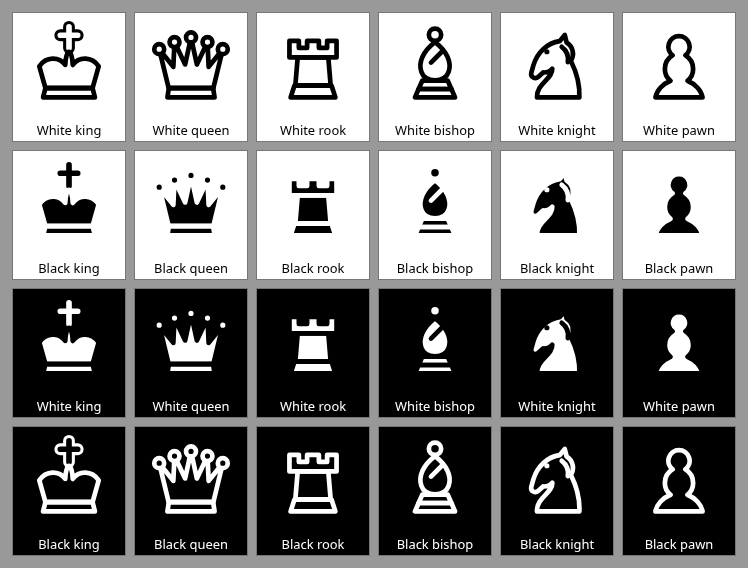

# Piece outlines on solid black and white — November 6, 2026

Kings now have a cross in their own piece colour, surrounded by a contrasting
outline. The previous cross was only an outline-coloured line, which could
disappear on a matching square. All six piece types now have a stronger outline
in pure black or white, selected for contrast with the piece fill. Custom piece
colours are preserved; theme previews use the same contrast policy.



The offline browser check rasterizes the actual piece SVGs and checks the king
cross centres/borders, every sampled opaque outer-contour pixel, and visibility
when composited on solid black and white. It covers all seven piece themes,
reversed custom black/white pieces and mid-grey pieces: **108 sprites, 216
background cases and 53,472 contour pixels** on the local Chromium run. Settings
swatches are checked too. Pixel totals may vary with browser rasterization.

```sh
node scripts/build.cjs --check
node scripts/browser-piece-contrast-test.cjs
```

Use the documented development-only Playwright/Chromium setup. The check serves
the single HTML from memory and disables page networking. It is part of browser
CI. The preview above shows the 24 pure black/white combinations and was visually
reviewed. Rendering changes apply to the shared board, lesson, promotion,
captured-piece and settings renderer. Engine, network, rules and clocks are
unchanged; the player still needs only index.html.
